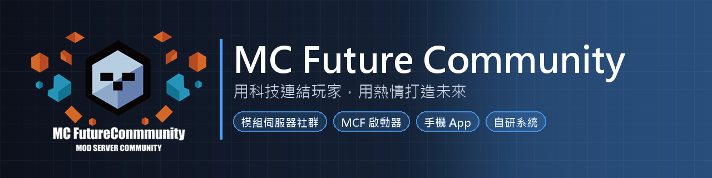

**用科技連結玩家，用熱情打造未來**

[加入 Discord](https://discord.gg/mcftw) · [官方網站](https://www.mfctw.net/) · [玩家中心](https://panel.mfctw.net/)

---

## 關於 MCF

**MC Future Community（MCF）** 是一個以技術為核心的 Minecraft 社群，由一群對模組伺服器充滿熱情的玩家與開發者共同建立。

我們相信，遊戲的本質不只是娛樂，更是連結人與人之間的橋樑。MCF 致力於讓每位玩家都能在穩定、流暢、有溫度的環境中享受模組 Minecraft 的樂趣——無論是剛踏入模組世界的新手，還是挑戰 GTNH 的資深玩家。

從 2022 年一個小型好友伺服器起步，MCF 逐漸發展成擁有完整自研基礎設施的社群生態系，持續與多個夥伴伺服器合作，為玩家提供多樣化的遊玩體驗。

---

## 我們提供什麼

- **MCF 啟動器** — 一鍵啟動，自動同步模組包，支援多帳號切換與皮膚預覽
- **手機 App** — 好友動態、私訊、公會、排行榜、掃碼登入，人不在電腦前也能跟社群保持連線
- **多元模組包** — 涵蓋輕量休閒到重度技術向（GTNH、GTO 等）的多種選擇，從 1.7.10 到最新的 26.1.2
- **官方網站與玩家中心** — 白名單申請、問題回報、帳號管理，一站搞定
- **跨伺服器社群** — 跨服聊天頻道、私訊、公會與隊伍、稱號與寶石、寵物，統一的權限系統與玩家資料，無縫銜接各夥伴伺服器
- **天眼反作弊** — 自動偵測複製物品、連點器、異常飛行等行為，管理員可即時觀看與回放，保護每位玩家的遊戲成果

---

## 自研技術

MCF 的整套系統都是自己開發與維護的：

| 項目 | 說明 |
|---|---|
| **MCF-Gate** | 自研的前端登入系統（Go），取代 Velocity：全版本登入（1.7.10 ~ 26.1.2）、伺服器重啟時玩家不斷線、人滿排隊 |
| **MCF 系統模組** | 遊戲端整合：權限、聊天、公告、TAB、稱號、天眼，支援 Forge／Fabric／NeoForge |
| **MCF API 與網頁後台** | 玩家資料、權限、經驗、商城、伺服器管理的核心服務 |
| **MCF 啟動器與手機 App** | 玩家端入口，與後台即時同步 |

---

## 如何加入

1. 加入我們的 **[Discord 社群](https://discord.gg/mcftw)**
2. 在 Discord 內申請白名單
3. 下載 **MCF 啟動器**，登入後選擇模組包開始遊玩

---

## 成為合作伺服器

想讓自己的伺服器接上 MCF 的帳號、權限、聊天與啟動器生態系？MCF-Gate 提供 Windows／Linux 單一執行檔，一個執行檔加一個設定檔就能把伺服器接進 MCF。歡迎到 [Discord](https://discord.gg/mcftw) 聯絡我們。

---

## 合作伺服器

| 伺服器 | 說明 |
|---|---|
| 憶蝶夢海 | MCF 起源伺服器 |
| 無名伺服器 | [namelessrealms.com](https://namelessrealms.com/) |
| GXsServer 2.0 | [gxsserver.com](https://www.gxsserver.com/) |
| LCT 伺服器 | 社群夥伴伺服器 |
| Danny's Modded Realm | 社群夥伴伺服器 |

---

## 核心團隊

| 成員 | 角色 |
|---|---|
| 小誠 (SteveBell) | 創辦人 & 全端開發 |
| 兔子老師 (yyyyyyh) | 後端開發 & 系統架構 |
| 阿倫 (Lun0225) | 前端開發 & GXsServer 管理員 |
| 龜龜 (him71553) | LCT 伺服器主 |
| 月月 (Moon_Flame) | 無名共同擁有者 & 除錯 |
| 浩浩 (Wolves_tw) | 社群管理 |
| Danny (Hi_Danny) | Danny's Modded Realm 伺服器主 |

---

**MC Future Community — 讓每一次冒險都值得被記住**

